# CRM Sales Opportunities — SQL Analysis Project

A data analysis project using the Maven Analytics "CRM Sales Opportunities"
dataset to extract business insights on sales performance, pipeline health,
product profitability, and account/regional trends. The project follows a
full analytics workflow — business understanding, data audit, schema design,
exploratory SQL, business analysis, advanced SQL, and visualization — using
MySQL for querying and Python (pandas, matplotlib, seaborn) for charts.

---

## Tools Used

- MySQL 8.0 + MySQL Workbench for database design and querying
- Python (pandas, SQLAlchemy, matplotlib, seaborn) for chart generation
- SQL: joins, subqueries, CTEs, window functions, aggregates, foreign key constraints

---

## Project Structure

```
SQL PROJECT/
├── CRM+Sales+Opportunities/  
├── docs/                      
│   ├── 01_business_understanding.md
│   ├── 03_er_diagram.md
│   ├── 04_exploratory_sql_guide.md
│   └── 05_business_questions.md
├── sql/
│   └── 01_schema.sql         
├── scripts/                 
│   ├── audit_dataset.py    
│   ├── exploratory_sql.sql  
│   └── business insights.sql  
├── python_scripts/          
├── visuals/                 
├── requirements.txt
└── README.md
```

---

## Key Analyses & Charts

### Sales Performance

- **Top Agents by Revenue**
  Ranks the top 10 sales agents by total Won revenue.
  `python_scripts/top_agents_by_revenue.py`
  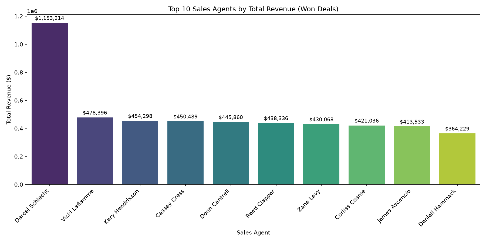

- **Win Rate by Manager**
  Compares each manager's team win rate (Won / (Won + Lost)).
  `python_scripts/win_rate_by_manager.py`
  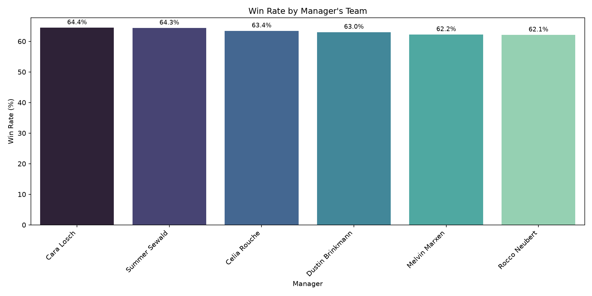

---

### Pipeline / Funnel Analysis

- **Deal Stage Funnel**
  Deal count across Prospecting → Engaging → Won/Lost.
  `python_scripts/deal_stage_funnel.py`
  

- **Sales Cycle Length: Won vs. Lost**
  Average number of days from engagement to close, split by outcome.
  `python_scripts/sales_cycle_won_vs_lost.py`
  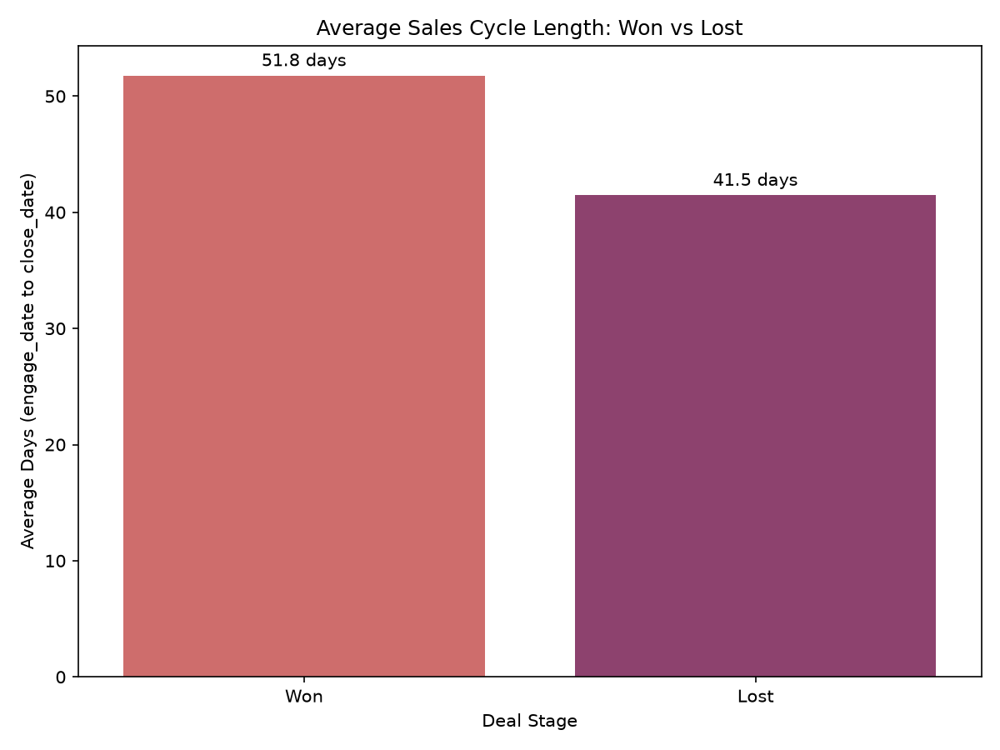

---

### Product Analysis

- **Revenue by Product Series**
  Total revenue rolled up by product series (GTX / GTK / MG).
  `python_scripts/revenue_by_product_series.py`
  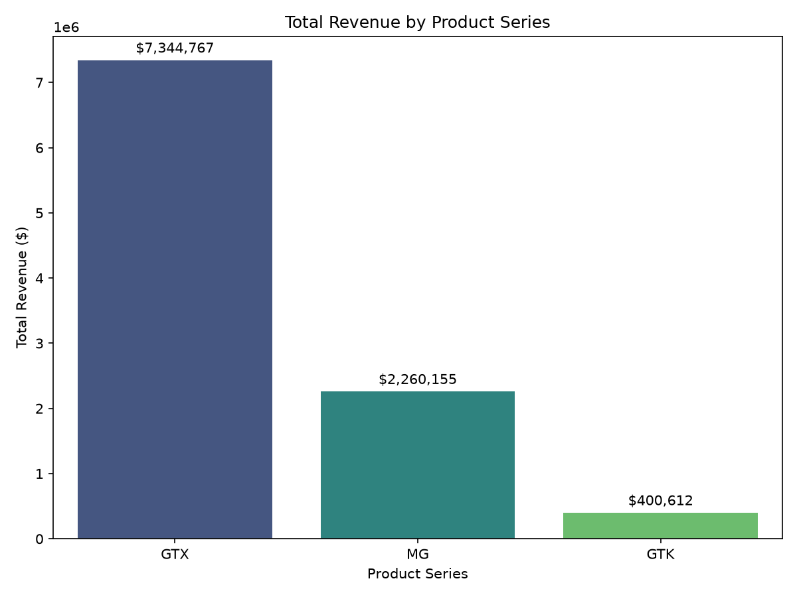

- **Discount vs. List Price**
  Average realized discount against list price, per product.
  `python_scripts/product_discount_analysis.py`
  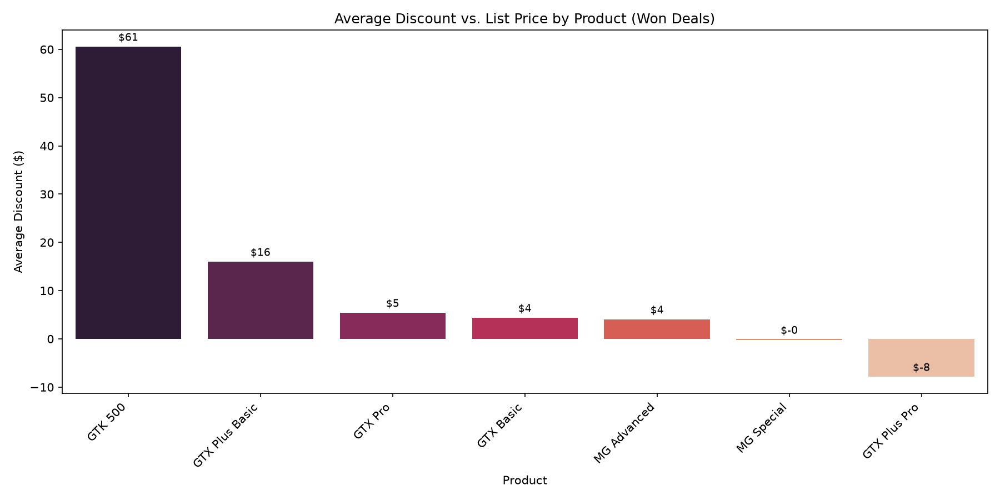

---

### Account / Sector Analysis

- **Revenue by Sector**
  Total revenue aggregated by customer industry sector.
  `python_scripts/revenue_by_sector.py`
  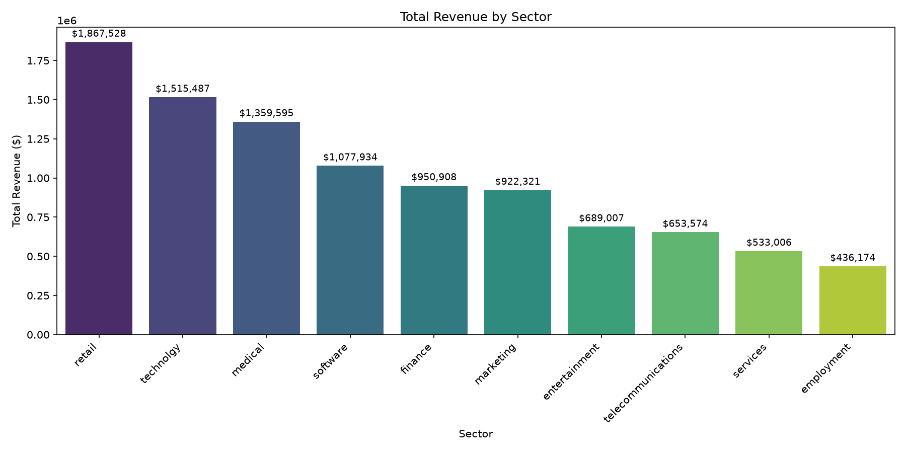

- **Company Size vs. Deal Size**
  Average deal size grouped by account company-size bucket.
  `python_scripts/company_size_vs_deal_size.py`
  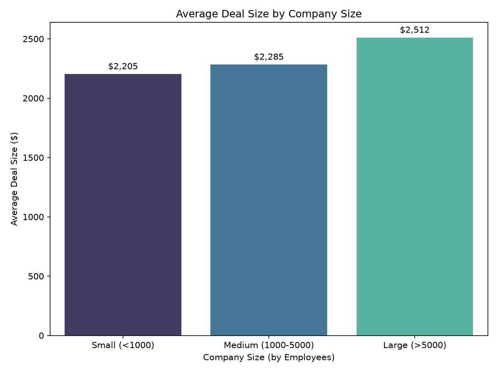

---

### Regional Analysis

- **Revenue by Region**
  Total revenue by regional office.
  `python_scripts/revenue_by_region.py`
  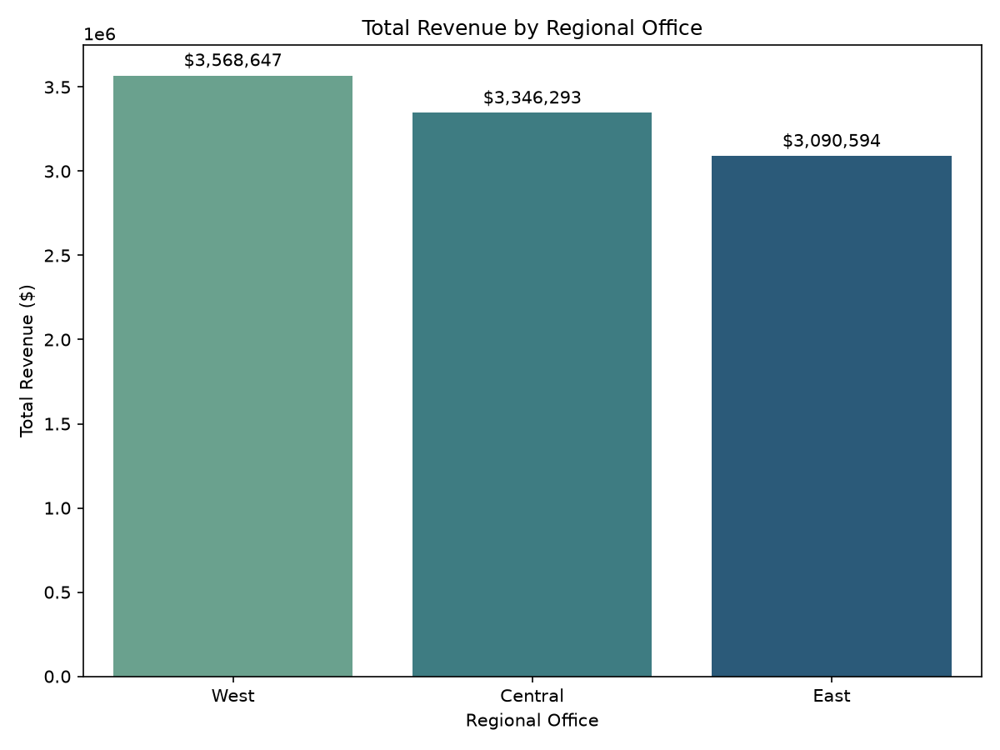

- **Revenue per Agent, by Region**
  Revenue-per-agent efficiency across regional offices.
  `python_scripts/revenue_per_agent_by_region.py`
  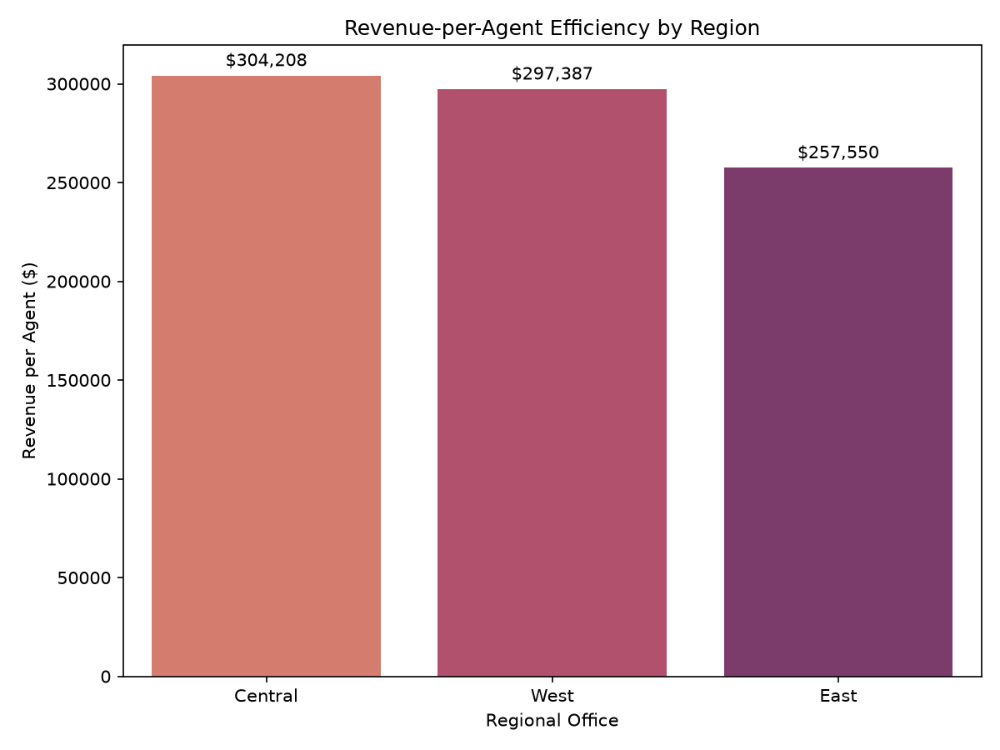

---

### Time-Based Trends

- **Monthly Revenue Trend**
  Monthly Won revenue across the full dataset time range.
  `python_scripts/monthly_revenue_trend.py`
  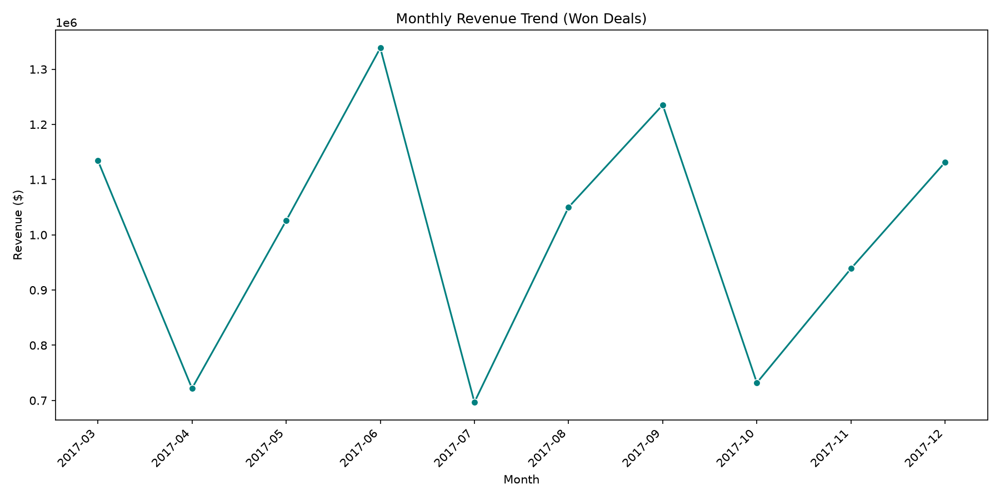

---

### Deal Size Analysis

- **Deal Size Distribution**
  Won deal count split into small / medium / large value buckets.
  `python_scripts/deal_size_distribution.py`
  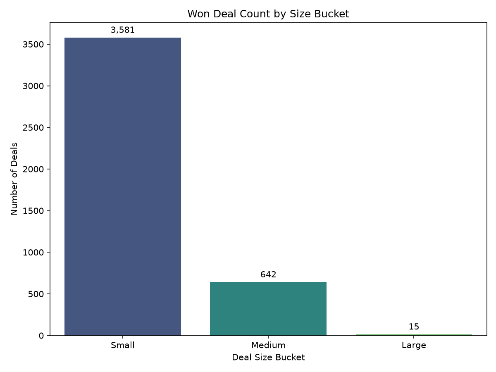

---

## How to Run

1. **Set up MySQL**
   Install MySQL 8.0, then run `sql/01_schema.sql` to create the database
   and tables.

2. **Load the data**
   Import the 4 CSVs from `CRM+Sales+Opportunities/` into their matching
   tables (see `docs/03_er_diagram.md` for load-order and data-quality notes
   — `sales_pipeline` in particular needs the `'GTXPro'` fix and NULL
   handling for blank cells before/while loading).

3. **Run the SQL analysis**
   Execute `scripts/exploratory_sql.sql` and `scripts/business insights.sql`
   in MySQL Workbench (or any MySQL client) to reproduce the full analysis.

4. **Generate the charts**
   ```bash
   pip install -r requirements.txt
   ```
   Set your DB credentials as environment variables, then run any script in
   `python_scripts/`:
   ```bash
   # PowerShell
   $env:DB_PASSWORD = "your_password_here"
   python python_scripts/top_agents_by_revenue.py
   ```
   (`DB_HOST`, `DB_USER`, `DB_NAME` default to `localhost`, `root`,
   `crm_sales_opportunities` respectively — override via environment
   variables if yours differ.)

---
